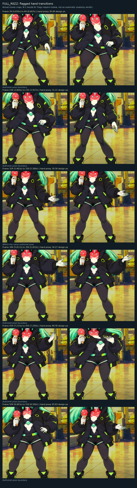
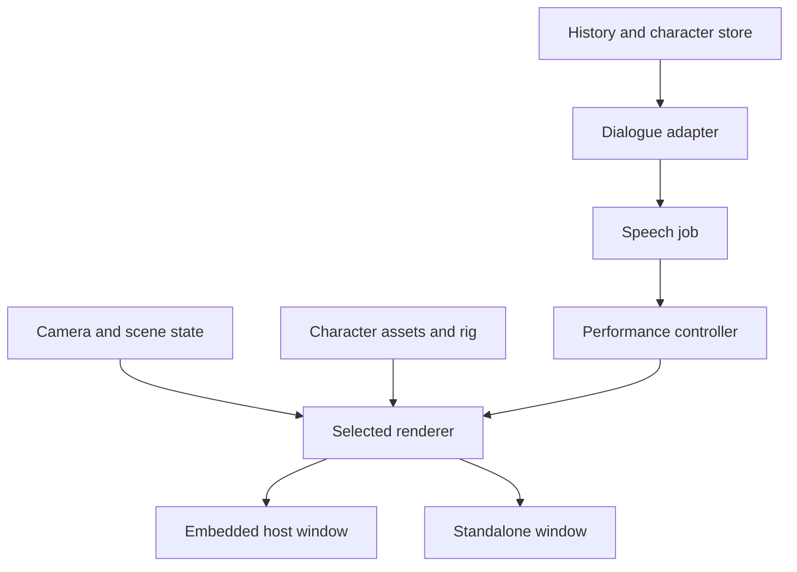

# FULL_REZZ voice-chat requirements and implementation audit

Review began 12 October 2026 and was finalized 13 October 2026, America/New_York. Baseline: renderer source 2.2, portable bridge 1.0 and frozen voice/desktop application 2.0. This audit reviews the supplied transcription, current source, delivered media, prior test/audit logs and newly extracted comparison frames. Original voice-chat audio and timecodes were not supplied.

## Main finding

The conversation defines a character companion engine with multiple real camera viewpoints, selectable 2D/3D presentation, full chat-history input and conversation in either an embedded window or a separate application. The current prototype renders one authored 2D performance and supplies technical/continuity checks. That complete companion engine is still to be implemented.

The last source update reused the exact previous movie: 2.2 added projection guides and continuity reports to the 2.1 export. It did not change that character footage. Your concern that it looks the same is therefore supported by file identity. The reported hand/body distortion remains open. A broad arm-deformation field is a plausible contributor, while source drawings and their registration also need review. Technical passes do not resolve anatomy or cinematography.

This package provides an actionable audit, 14 findings, eight traceable requirements, all 32 frame-review items, six actual adjacent-frame hand comparisons and a proposed next-build format/specification. It changes documentation and review materials only. It does not claim a new renderer, generated views, imported character history or rebuilt installer.

## Transcript interpretation

Message IDs refer to `FULL_REZZ_Voice_Chat_Transcript.json`. Message 12's continuation is joined from the two supplied context blocks. Supplied transcription is preserved; assistant assertions and lookup failures are conversation context rather than acceptance evidence.

| Requirement | User messages | Audit meaning |
| --- | --- | --- |
| Visible improvement and comparison | 2, 6, 10 | Publish actual changed footage with an inspectable comparison. |
| Natural hand/body behavior | 10, 12, 14 | Review torso/arm coupling, source poses, hands, props and transitions. |
| Multiple actual character views | 4, 6, 12, 14 | Add view assets/backends and a camera/shot controller. |
| Selectable 2D/3D | 12, 14 | Preserve one identity across supported visual representations. |
| Entire chat history on a character | 14 | Add explicit parsing, durable memory and source provenance. |
| Talk to the manifested character | 14 | Link actual dialogue output to speech and fresh performance. |
| Host window and standalone app | 14 | Share one engine/session core across both presenters. |
| Original cinematic benchmark | 6, 8, 10, 12 | Exact anime matching was relaxed and the Maelstrom comparison was skipped. Local work can proceed without that scene. |

The earlier discussion paused at message 16. The current request resumes review. A six-shot benchmark, detailed engineering thresholds and input-format recommendations are proposals derived from the goal; they are not previously completed features.

## Verified baseline and evidence scope

| Area | Current evidence | Scope |
| --- | --- | --- |
| Movie | 1920 × 1080, 60 fps, 720 frames, 12 seconds; SHA256 `b74f599a5eebeaf5a07a069d706a440d4614e12fc654458b063bf838b9ced97e` | Exact 2.1 export reused by 2.2. |
| Drawing library | 24 registered poses; 23 scheduled drawings | Bounded uncalibrated pose bank, not guaranteed front/side/back coverage. |
| Rig | Weighted hand-driven cel mesh, face/foot protections, offset and triangle-area guards | Deformation bounds; no complete limb skeleton or semantic torso mask. |
| Camera | `scene.py:render()` applies a ground-pivot zoom to raster actor/background | Fixed-move 2D compositing. No actual multi-view character shot graph. |
| Geometry | Orthographic/perspective wireframe projection and flat-guide continuity checks | Useful math and diagnostics; no surfaced/skinned 3D avatar backend. |
| Prior checks | 84 Python tests, 14 simulated player tests, 12 exhaustive render checks and four continuity checks | Historical passes in their stated scopes; not live-companion, native Windows or artistic acceptance. |
| Remaining flags | 26 silhouette and six hand flags | 32 review items: 29 at pose boundaries, three within a pose. |
| Largest hand proxy step | 45.829 design pixels at frame 510, 8.500 seconds | A discontinuity to inspect, not an anatomical-error or likeness score. |
| Export time | 225.26 seconds for the 12-second production export | Offline export measurement. 60 fps delivery does not establish live 60 Hz rendering. |
| Context/playback | `to_engram()` records `reasoning_engine_executed=false`; legacy `action_plan()` requires `automatic_reanimation=false` | Data mapping and authored playback, without a full dialogue/history/live-animation loop. |
| Host/Windows | Existing reports mark host incorporation/native Windows acceptance false | Added source is not in a newly accepted companion installer. |

This review verified the saved source archive checksum/CRC and movie identity, inspected the code/logs, evaluated the arm influence field and decoded the six flagged hand transitions. The historical full test suite and exhaustive codec/audio audit were not rerun as new-engine acceptance. No popular-scene comparison or formal human artistic approval occurred.

## Hand/body distortion and repair criteria

`rig.py:arm_weights()` defines a Gaussian around the hand with source-pixel radii 85 horizontally and 95 vertically. Its face/foot suppression does not create explicit torso, elbow, hand or prop domains. `CelMesh.mapping()` displaces points using this field, caps hand offset at 45 source pixels and preserves triangle orientation/area. Those guards can still permit an implausible contour or nearby body motion.

A fresh numerical probe sampled three hand-adjacent opaque interior locations for each of 24 cels. Forty-six of 72 points had nonzero influence. In `a1`, `[238.65,268]` has normalized weight 0.2525; an illustrative 20-source-pixel hand delta assigns approximately 5.05 pixels of field displacement there. Two other `a1` probes receive about 8.73 and 10.29 pixels. These are continuous-function probes, not anatomical torso labels, actual triangle-interpolation measurements or observed frame displacements. See `evidence/voice-chat-arm-influence.json`.

Pose registration is another review target: `a1` uses a lower horizontal scale around 1.158 with differing upper/lower transforms and a blend region. This can change proportions before animation. Both authored drawings and the rig must therefore be inspected; a field probe alone does not prove the origin of every visual defect.

Repair by introducing authored torso/limb/hand/prop masks or layers, shoulder-elbow-wrist relationships and a protected torso during hand-only motion. Treat props as separately controlled objects. Retain face and contact controls, but make contacts and calibration character/shot-specific. Replace or redraw unsuitable poses and add corrective poses where the artwork cannot sustain the intended movement.

Proposed focused test: disable breathing and camera motion; sweep the hand across the declared supported range; keep protected torso/head/prop/boot contours and landmarks within a declared 0.5-source-pixel tolerance. This is an engineering target, not a measured studio standard. Then review joint placement, hand shape, clothing volume, unwanted stretch and contour continuity visually. Deliberate exaggeration needs a documented authored decision.

## Frame inspection materials

`FULL_REZZ_Frame_Review_Queue.csv` includes every original flag with frame, time, kind, measurement and boundary status. The image below compares actual decoded frame N-1 and N at all six hand flags. Crops retain delivery pixels without resizing or generated detail; they show hand/torso regions, not the complete scene. Exact source hash, selection and crop bounds are recorded in `evidence/voice-chat-frame-comparison.json`.

| Frame | Time | Hand proxy step | Boundary |
| --- | --- | --- | --- |
| 40 | 0.667 s | 30.690 px | Authored pose change |
| 235 | 3.917 s | 31.209 px | Authored pose change |
| 330 | 5.500 s | 30.581 px | Same authored pose |
| 350 | 5.833 s | 34.269 px | Authored pose change |
| 435 | 7.250 s | 40.584 px | Authored pose change |
| 510 | 8.500 s | 45.829 px | Authored pose change |

Each queue row needs either a visual edit or a reviewed rationale for intentional staging, with reviewer and supporting frames. Changing thresholds to erase the queue is not a visual repair.

## Proposed character and camera framework

Keep one stable identity for authored lore, history, voice profile and appearance assets. Changing presentation must not silently change the companion's context or voice. The draft schema and example illustrate those bindings; the current renderer/bridge do not consume them.

| Mode | Needed inputs | Availability rule |
| --- | --- | --- |
| Authored multi-view 2D | Calibrated front/three-quarter/profile/rear view banks, part rigs and corrective poses | Offer real available views, with explicitly labeled fallback. |
| Rigged 3D | Actual surfaces, textures, skeleton/weights, joint mapping, clips and an implemented loader/renderer | Verify coherent front/side/back surfaces and occlusion during orbit. |
| Legacy 2D | Existing cels and scene-specific calibration | Retain supported legacy playback; current angles remain unmeasured. |

The proposed transport for a rigged asset is glTF/GLB. The [Khronos specification](https://registry.khronos.org/glTF/specs/2.0/glTF-2.0.html), consulted 12 October, defines meshes, skins, cameras and animations. Choosing that format does not implement a renderer. Convert coordinate conventions and scale explicitly: the current image-plane guide is not measured world geometry.

Add a shared scene/camera controller and editable shot timeline. A close-up crop changes framing but supplies no hidden side/back surfaces. Preserve character state, props, contact phases, lighting and action timing across cuts. The proposed 12-second/60 fps benchmark has six two-second shots: wide front, medium reaction, front three-quarter, profile, rear three-quarter/over-shoulder and a low/high-angle action or prop insert. Missing views need actual assets or an implemented, reviewed asset-creation pipeline.

A new shared-time comparison should display both media hashes, camera/view IDs and actual changed footage. Review staging, viewpoint coverage, pose readability, arcs, contacts, props, contour quality and lighting intent. Artistic acceptance remains separate from compression/integrity checks; this audit assigns no studio-equivalence score.

## Full history and companion window

Import supported chat logs with message IDs, roles, content, source spans and available timestamps. CSV needs an explicit role/content mapping, JSON a validated structure, and ambiguous text a reviewed speaker mapping. Store all accepted messages durably; use chunking/retrieval for model context without silently deleting stored history. Over-limit and rejected imports need visible errors and atomic rollback. Imported messages must not become executable application policy.

History supplies conversational context and reviewed memory. It does not supply missing geometry or train a voice itself. Keep authored lore, imported history, provider configuration, voice references and visual assets as separately verified bindings. This project-planning voice chat is audit input, not Rebecca's fictional memories.

This is a target architecture. Reuse the host text provider where available; the standalone application needs its own implemented configuration. Test an actual reply round trip, then bind its actual speech output to a shared audio/sample clock. Label energy-based mouth motion and phoneme alignment as distinct capabilities. Authored idle/talk/gesture states are a practical first set; arbitrary new action generation needs further assets and control.

Both presenters should share a character/session/render core and job lifecycle. Test mode/character switching, history retention, asset errors, cancellation, restart and resizing. Keep UI/render/audio responsive while inference and exports run asynchronously. Package required runtimes/assets/models inside the standalone installer and run native offline acceptance, preserving current notices and data policies.

## Findings and next-build order

`FULL_REZZ_Audit_Findings.csv` has 14 items with priority, evidence status, transcript IDs, source references, proposed repair and acceptance criteria. It distinguishes file facts, user observations, inferred mechanisms, missing capabilities and unperformed acceptance. Its proposed tests have not been run against a new engine.

1. Constrain hand/body domains and correct poses; resolve or artistically justify the 32 flags with visible comparisons.
2. Add manifests, calibrated 2D views and a real rigged 3D renderer; complete the six-shot benchmark.
3. Implement full history ingestion and actual dialogue → voice → live performance in both presenters.
4. Package Windows delivery and run native offline, live-performance and artistic acceptance.

`FULL_REZZ_Next_Build_Spec.json` records the full target contract and dependencies. Actual host source, missing visual rigs, configured providers and a Windows acceptance environment remain implementation inputs, not blockers to this completed review. Preserve legacy profile IDs/extensions and the legacy `automatic_reanimation=false` guard; implement and version a new live-performance protocol instead of flipping flags.

## Release gate and audit limits

Current runtime source remains 2.2. This review adds audit documents, draft format/example, numerical evidence and comparison images. It does not build missing backends, generate viewpoints, ingest character histories, render new performances, retrain voices or rebuild Windows. Formal draft-schema metaschema validation and new-engine acceptance remain unperformed.

The requested product is complete when real assets and both supported render paths work, actual dialogue produces fresh linked speech/performance in both deployment modes, native offline installation succeeds and the remaining visual defects have reviewed resolutions. Keep each technical pass and design material labeled with its actual scope until those gates are met.
